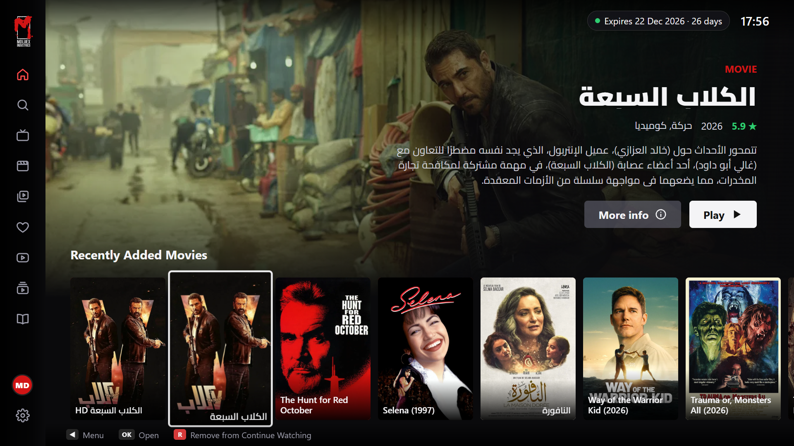
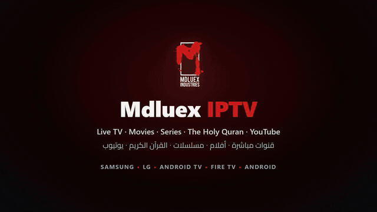
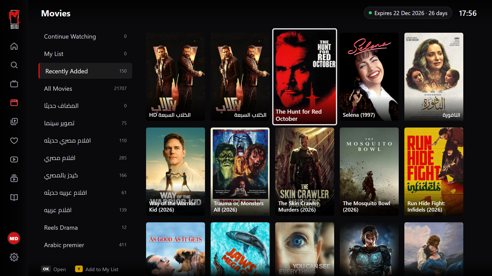
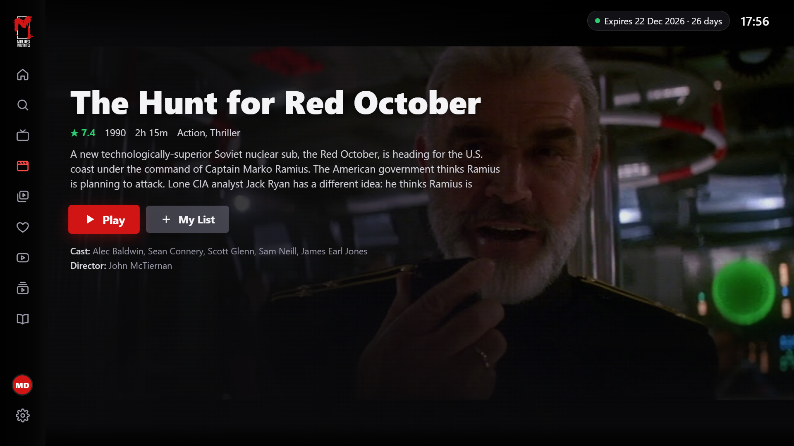
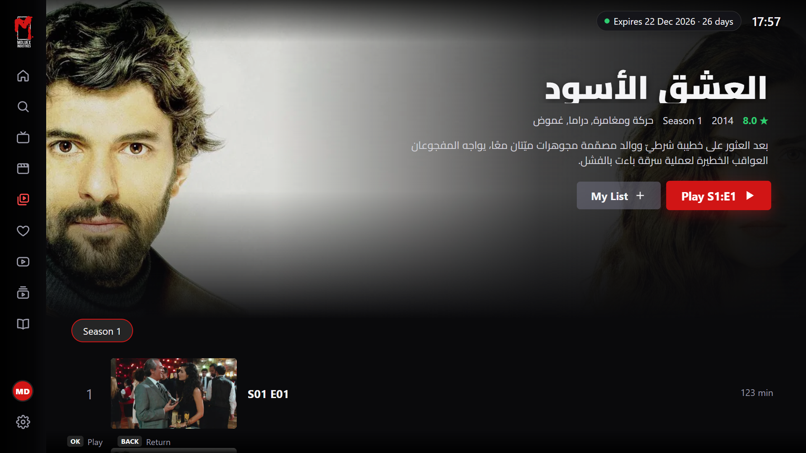
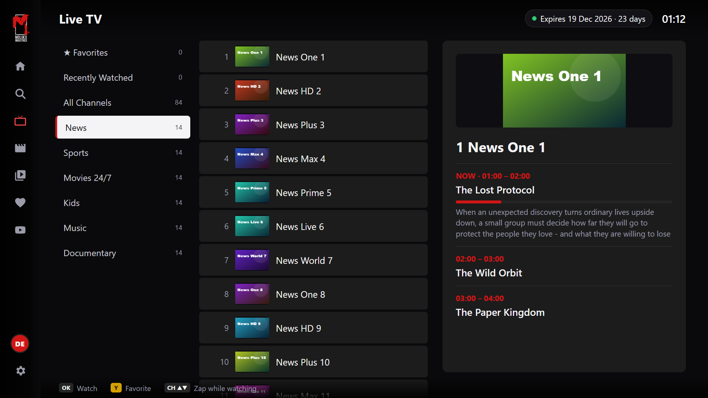

<div dir="rtl">

<p align="left"><a href="README.md"><b>Read in English 🇬🇧</b></a></p>

# Mdluex IPTV

### 👈 ثبّته على شاشتك: **[iptv.mdluex.com](https://iptv.mdluex.com)**
اختر شاشتك واتبع الصور — مع أزرار تحميل أحدث إصدار (بالعربية والإنجليزية).

شاهد اشتراك الـ IPTV الخاص بك على شاشتك الذكية في تطبيق أنيق بأسلوب Netflix: القنوات المباشرة والأفلام والمسلسلات
في مكان واحد. ويضم التطبيق أيضًا قناة **Mdluex Industries** على يوتيوب، ويمكنك مشاهدتها بدون أي اشتراك.

يعمل على شاشات **سامسونج** و**إل جي** و**Android TV / Google TV** و**Amazon Fire TV**.

> **معلومة مهمة:** تطبيق Mdluex IPTV مجرد مشغّل فقط، ولا يحتوي على أي قنوات أو أفلام أو مسلسلات. أنت تسجّل الدخول
> باشتراك الـ IPTV الذي لديك بالفعل (عنوان السيرفر واسم المستخدم وكلمة المرور التي أعطاها لك مزوّد الخدمة —
> ويُسمّى غالبًا حساب "Xtream Codes").



## المحتويات
- [تثبيت التطبيق على شاشتك](#install)
- [أول مرة: أضف اشتراكك](#first-time)
- [استخدام الريموت](#remote)
- [مميزات التطبيق](#features)
- [التحديث](#updating)
- [مشاكل وأسئلة](#help)
- [صور وفيديو](#screenshots)
- [الترخيص](#license)

<a id="install"></a>
## تثبيت التطبيق على شاشتك
اختر نوع شاشتك:

| شاشتك | الصعوبة | اذهب إلى |
|---|---|---|
| **Amazon Fire TV** (ستيك، Cube، شاشات Fire TV) | سهل — حوالي 5 دقائق | [Fire TV](#firetv) |
| **Android TV / Google TV** (Chromecast، Shield، Mi Box، سوني، TCL، هايسنس…) | سهل — حوالي 5 دقائق | [Android TV](#androidtv) |
| **سامسونج** (موديلات 2018 وأحدث) | متوسط — تحتاج موبايل أو كمبيوتر مرة واحدة | [سامسونج](#samsung) |
| **إل جي** (موديلات 2021 وأحدث، webOS 6 أو أحدث) | أصعب — تحتاج كمبيوتر مرة واحدة | [إل جي](#lg) |

<a id="firetv"></a>
### Amazon Fire TV
1. على جهاز Fire TV، ابحث في متجر التطبيقات عن **Downloader** وثبّته (مجاني).
2. اذهب إلى **Settings → My Fire TV → Developer options → Install unknown apps** وفعّلها لتطبيق **Downloader**.
   - لا تجد *Developer options*؟ اذهب إلى **Settings → My Fire TV → About**، واضغط على اسم جهازك
     **7 مرات**، ثم ارجع للخلف وستظهر.
3. افتح **Downloader**، واكتب هذا العنوان ثم اضغط **Go**:
   <div dir="ltr">

   ```
   mdluex.github.io/mdluex-iptv/apk
   ```
   </div>
4. سيتم تحميل أحدث إصدار تلقائيًا. اختر **Install** ثم **Open**.
5. بعد ذلك ستجده في **Your Apps & Channels**.

> بعض أحدث أجهزة Fire TV تعمل بنظام **Vega OS** بدلًا من Fire OS، وهذه الأجهزة لا تسمح بتثبيت تطبيقات من خارج متجر
> أمازون، لذلك لن يعمل عليها Mdluex IPTV.

<a id="androidtv"></a>
### Android TV / Google TV
1. على الشاشة، ثبّت تطبيقًا مجانيًا لتحميل الملفات، مثل **Downloader** من متجر Google Play.
2. افتحه واذهب إلى هذا العنوان:
   <div dir="ltr">

   ```
   mdluex.github.io/mdluex-iptv/apk
   ```
   </div>
3. عندما يطلب أندرويد، اسمح له **بتثبيت التطبيقات غير المعروفة** (Install unknown apps)، ثم اختر **Install**.
4. افتح **Mdluex IPTV** من قائمة التطبيقات.

يمكنك أيضًا تحميل الملف الذي ينتهي بـ **`-android.apk`** من
[أحدث إصدار](https://github.com/mdluex/mdluex-iptv/releases/latest) على الكمبيوتر، ونسخه على فلاشة USB،
ثم فتحه على الشاشة بأي مدير ملفات.

<a id="samsung"></a>
### سامسونج
شاشات سامسونج لا تقبل التطبيقات من خارج متجرها إلا إذا كان التطبيق مُجهّزًا لشاشتك أنت بالتحديد. أداة مجانية اسمها
**Apps2Samsung** تقوم بذلك بدلًا منك.

**الخطوة 1 — على الشاشة: فعّل وضع المطوّر (Developer Mode)**
1. افتح **Apps** على الشاشة.
2. اضغط **1 2 3 4 5** على الريموت (لو الريموت بدون أرقام، استخدم لوحة الأرقام التي تظهر على الشاشة). ستفتح نافذة
   *Developer Mode*.
3. اجعلها **On**، وفي خانة **Host PC IP** اكتب عنوان الموبايل أو الكمبيوتر الذي ستستخدمه في الخطوة 2.
   (على الموبايل: الإعدادات ← Wi-Fi ← شبكتك ← عنوان IP.)
4. أطفئ الشاشة ثم شغّلها مرة أخرى.

**الخطوة 2 — على الموبايل أو الكمبيوتر: ثبّت التطبيق باستخدام Apps2Samsung**
1. حمّل **[Apps2Samsung](https://github.com/Apps2Samsung/Apps2Samsung)** (ويندوز، ماك، لينكس، أندرويد أو آيفون).
   يجب أن يكون الموبايل أو الكمبيوتر على نفس شبكة الـ Wi-Fi مثل الشاشة.
2. افتح Apps2Samsung وابحث عن **Mdluex IPTV** في قائمة التطبيقات (في قسم *Media servers & players*، أو استخدم البحث).
3. ثبّته. في أول مرة سيطلب منك تسجيل الدخول بحساب سامسونج مجاني — وهذا شرط من سامسونج حتى يعمل التطبيق على شاشتك.

> لا تجده في القائمة؟ في Apps2Samsung افتح **Settings → Installing → Your sources**، وأضف
> `github.com/mdluex/mdluex-iptv`، ثم ابحث مرة أخرى.

<details>
<summary><b>تفضّل كمبيوتر ويندوز؟ استخدم برنامج التثبيت بضغطة واحدة</b></summary>

1. نفّذ *الخطوة 1* بالأعلى، واكتب عنوان الكمبيوتر في **Host PC IP**.
2. على الكمبيوتر، حمّل الملف الذي ينتهي بـ **`.zip`** من
   [أحدث إصدار](https://github.com/mdluex/mdluex-iptv/releases/latest)، وفك الضغط عنه، ثم اضغط مرتين على
   **`Install-MdluexIPTV.cmd`**.
3. اتبع الشاشات: سيبحث عن شاشتك، ويجهّز كل ما يحتاجه، ويطلب منك تسجيل الدخول بحساب سامسونج مرة واحدة، ثم يثبّت
   التطبيق. شغّله مرة أخرى في أي وقت للتحديث.
</details>

<a id="lg"></a>
### إل جي
إل جي لا تسمح بالتطبيقات من خارج متجرها إلا عن طريق تطبيق **Developer Mode** الخاص بها، بالإضافة إلى متجر مجتمعي
مجاني اسمه **Homebrew Channel**. ستجهّز هذا مرة واحدة فقط، وبعدها يصبح التثبيت والتحديث سهلًا.

1. من الكمبيوتر أو الموبايل، أنشئ حسابًا مجانيًا على
   [webostv.developer.lge.com](https://webostv.developer.lge.com).
2. على الشاشة، ثبّت تطبيق **Developer Mode** من متجر LG Content Store، وسجّل الدخول بنفس الحساب، وفعّل
   **Dev Mode Status**. ستعيد الشاشة التشغيل.
3. ثبّت **Homebrew Channel** على الشاشة باتباع
   [دليل Homebrew Channel](https://www.webosbrew.org/devmode/) (يستخدم برنامجًا مجانيًا على الكمبيوتر اسمه
   *webOS Dev Manager*).
4. على الشاشة افتح **Homebrew Channel → Settings → Add repository** واكتب:
   <div dir="ltr">

   ```
   https://mdluex.github.io/mdluex-iptv/lg/apps.json
   ```
   </div>
5. ارجع لقائمة التطبيقات، وابحث عن **Mdluex IPTV** وثبّته.

> وضع المطوّر في إل جي يتوقف تلقائيًا بعد 1000 ساعة (حوالي 6 أسابيع). افتح تطبيق **Developer Mode** على الشاشة من وقت
> لآخر واضغط **Extend** حتى تستمر تطبيقاتك في العمل.

<a id="first-time"></a>
## أول مرة: أضف اشتراكك
1. افتح **Mdluex IPTV** واختر **Add IPTV playlist**.
2. اكتب البيانات التي أعطاها لك مزوّد الـ IPTV:
   - **Name** (الاسم) — أي اسم تحبه، مثل *My IPTV*
   - **Server address** (عنوان السيرفر) — مثل `http://example.com:8080`
   - **Username** (اسم المستخدم) و**Password** (كلمة المرور)
3. احفظ. ستظهر قنواتك وأفلامك ومسلسلاتك، وسيظهر تاريخ انتهاء اشتراكك في أعلى الشاشة.

**أسهل: اكتبها على هاتفك.** نافذة *إضافة قائمة* تعرض أيضًا **رمز QR**. امسحه بكاميرا هاتفك، واكتب بيانات الدخول
هناك (أو الصق رابط M3U وسيملأ الباقي)، ثم اضغط **إرسال**. ستظهر على الشاشة وتُحفظ تلقائيًا، وتُرسل مشفّرة بمفتاح
لا يملكه إلا تلفزيونك.

تريد أن تتفرّج على التطبيق أولًا؟ اختر **Try demo** لمحتوى تجريبي، أو **Watch Mdluex Channel**.
يمكنك إضافة أكثر من اشتراك والتبديل بينها من **Settings** (الإعدادات).

<a id="remote"></a>
## استخدام الريموت
الأسهم للتنقّل، و**OK** للاختيار، و**Back** للرجوع. وهناك أزرار إضافية تختلف حسب الريموت:

| لكي… | ريموت سامسونج / إل جي | ريموت Fire TV | ريموتات Android TV الأخرى |
|---|---|---|---|
| تضيف أو تحذف من **My List** (قائمتي) | 🟡 الزر الأصفر | **☰** (Menu) | **اضغط مطوّلًا على OK** |
| تحذف من **Continue Watching** (متابعة المشاهدة) | 🔴 الزر الأحمر | **☰** (Menu) | **اضغط مطوّلًا على OK** |
| تغيّر القناة أثناء المشاهدة | **CH ▲▼** أو **▲▼** | **▲▼** | **▲▼** |
| تعرض قائمة القنوات أثناء المشاهدة | **◀** | **◀** | **◀** |
| ترجيع / تقديم | **◀ ▶** (اضغط مطوّلًا للأسرع) | نفس الشيء | نفس الشيء |
| لغة الصوت، الترجمة، حجم الصورة، مؤقّت النوم، الحلقة التالية | **▲** أثناء المشاهدة | نفس الشيء | نفس الشيء |

أسفل الشاشة يوضّح دائمًا وظيفة كل زر في الصفحة التي أنت فيها.

<a id="features"></a>
## مميزات التطبيق
- **أكمل من حيث توقفت** — الأفلام والحلقات والفيديوهات تتذكر آخر مكان وصلت إليه.
- **القنوات المباشرة** مع شعارات القنوات، ودليل البرامج (ما يُعرض الآن والتالي)، والمفضّلة، وآخر القنوات التي شاهدتها، والقناة التي تتوقف عندها تُعرض بالصوت في بطاقة المعاينة.
- **أفلام ومسلسلات** مع البوسترات، و*المضاف حديثًا*، و*قائمتي*، والمواسم والحلقات، وتشغيل الحلقة التالية تلقائيًا.
  أثناء المشاهدة اضغط ▼ لأزرار **الحلقة السابقة / كل الحلقات / الحلقة التالية** (أو CH ▲▼): تُكمل كل حلقة من حيث
  توقفت، و*كل الحلقات* تعرض حلقات الموسم بجانب الفيديو.
- **بحث** في القنوات والأفلام والمسلسلات وفيديوهات Mdluex.
- **اختيار لغة الصوت والترجمة** (يُحفظ لكل فيلم ومسلسل)، وتغيير حجم الصورة، و**مؤقّت النوم**.
- **قفل الأطفال** للأقسام الخاصة بالكبار برقم سري (الرقم الافتراضي **0000** — غيّره من الإعدادات).
- **العربية أو الإنجليزية** — التطبيق يتبع لغة شاشتك تلقائيًا، وبالعربية يصبح التطبيق كله من اليمين لليسار.
  يمكنك تغييرها في أي وقت من **Settings ← Language** (الإعدادات ← اللغة).
- **تاريخ انتهاء اشتراكك** يظهر دائمًا، والتطبيق يستمر في العمل بآخر بيانات معروفة إذا كان السيرفر بطيئًا.
- **قناة Mdluex Industries** — شاهد قناة اليوتيوب داخل التطبيق بدون أي اشتراك.
- **قنوات يوتيوب الخاصة بك** — من **قنوات يوتيوب** اختر **إضافة قناة** وابحث بالاسم أو @المعرّف أو الرابط.
  ستظهر أحدث فيديوهاتها في الرئيسية أيضًا. (قناة Mdluex Industries ثابتة دائمًا.)
- **القرآن الكريم** — اختر السورة والقارئ، واستمع وأنت تقرأ: الصفحة بشكل المصحف المطبوع، والآية والكلمة التي
  تُتلى تضيء أثناء الاستماع. ١٢ قارئًا مشهورًا، وتكرار الآية، والانتقال للسورة التالية، ويتذكر أين توقفت.
  ▲▼ للتنقل بين الآيات، و◀▶ بين السور.
- **هواتف أندرويد** — تصميم أكبر مناسب لشاشة الهاتف، ولمس في كل مكان: مرّر بإصبعك، والمس للفتح، واضغط مطوّلًا
  للخيارات، واسحب شريط الوقت للتقديم، واسحب في صفحة القرآن، وفي القنوات المباشرة اللمسة الأولى تعرض القناة والثانية تشغّلها.
- **الشاشات الأقدم أيضًا** — سامسونج من 2018 (Tizen 4) وشاشات إل جي الأقدم (webOS 3.5 وأحدث).

<a id="updating"></a>
## التحديث
- **Fire TV / Android TV:** كرّر خطوات التثبيت (Downloader → `mdluex.github.io/mdluex-iptv/apk`). سيبقى اشتراكك
  ومفضّلتك كما هي.
- **سامسونج:** سيظهر التحديث في Apps2Samsung — ثبّته من هناك.
- **إل جي:** سيظهر التحديث في Homebrew Channel.

<a id="help"></a>
## مشاكل وأسئلة
**قناة مباشرة تقف أو لا تعمل.**
اذهب إلى **Settings → Live TV stream type** وبدّل بين *MPEG-TS* و*HLS*. غالبًا يعمل أحدهما أفضل مع مزوّد الخدمة.
وإذا لم تعمل، فقد تكون القناة متوقفة عند مزوّد الخدمة نفسه.

**يقول إن بيانات الدخول خطأ أو إن الاشتراك منتهي.**
تأكّد من عنوان السيرفر واسم المستخدم وكلمة المرور مع مزوّد الـ IPTV. التطبيق لا يستطيع حل مشاكل الاشتراك — مزوّد
الخدمة فقط هو من يستطيع.

**رسالة "Too many connections" (اتصالات كثيرة).**
اشتراكك يسمح بعدد محدد من الشاشات في نفس الوقت. أوقف المشاهدة على جهاز آخر ثم حاول مرة أخرى.

**سامسونج: المثبّت بضغطة واحدة يقول `install failed[118012]`.**
الشاشة لا تقبل توقيع التطبيق. شغّل المثبّت مرة أخرى — أصبح يمنح الشاشة الإذن ويحذف أي نسخة قديمة موقّعة من شخص آخر
ثم يعيد المحاولة. وإذا استمرت المشكلة استخدم **Apps2Samsung** بدلًا منه.

**سامسونج: Apps2Samsung لا يجد الشاشة أو لا يتصل بها.**
تأكّد أن الموبايل/الكمبيوتر والشاشة على نفس الـ Wi-Fi. أحيانًا يغيّر الراوتر العناوين: راجع عنوان الموبايل/الكمبيوتر
مرة أخرى، واكتبه في **Developer Mode → Host PC IP** على الشاشة، ثم أعد تشغيل الشاشة.

**إل جي: التطبيق توقف عن الفتح بعد عدة أسابيع.**
انتهت مدة وضع المطوّر. افتح تطبيق **Developer Mode** على الشاشة، وسجّل الدخول، وفعّله مرة أخرى (أو اضغط **Extend**
قبل أن تنتهي المدة).

**نسيت الرقم السري لقفل الأطفال.**
الرقم الافتراضي هو **0000**. إذا غيّرته ونسيته، احذف التطبيق وثبّته من جديد (على Fire TV وAndroid TV يمكنك بدلًا من
ذلك مسح بيانات التطبيق من إعدادات التطبيقات في الشاشة). هذا سيحذف اشتراكك المحفوظ أيضًا، فستحتاج لإضافته مرة أخرى.

**هل التطبيق بفلوس؟ هل فيه قنوات؟**
التطبيق مجاني، ولا يحتوي على أي قنوات — تحتاج اشتراك IPTV خاص بك.

ما زالت عندك مشكلة؟ راسلنا على **[hello@mdluex.com](mailto:hello@mdluex.com)** أو [افتح بلاغًا (Issue)](https://github.com/mdluex/mdluex-iptv/issues) — واكتب موديل شاشتك وما يحدث معك.

<a id="screenshots"></a>
## صور وفيديو
[](docs/demo.mp4)

▶ **[شاهد الفيديو التجريبي (1:42)](docs/demo.mp4)** — مُسجّل على شاشة سامسونج.

| | |
|---|---|
|  |  |
| الأفلام | تفاصيل الفيلم |
|  |  |
| المسلسلات والمواسم والحلقات | القنوات المباشرة مع دليل البرامج |

## شغّل سيرفر IPTV خاص بك
عندك أفلام أو مسلسلات أو قنوات خاصة بك؟ **[Mdluex IPTV Server](server/README.md)** برنامج سيرفر مجاني لويندوز مع
لوحة تحكم سهلة من المتصفح. يعمل مع هذا التطبيق ومع أي مشغّل IPTV آخر. (الشرح بالإنجليزية.)

## للمطوّرين
طريقة بناء التطبيق واختباره ونشره: **[DEVELOPERS.md](DEVELOPERS.md)** (بالإنجليزية).

<a id="license"></a>
## الترخيص
**مجاني للاستخدام الشخصي** — راجع [LICENSE](LICENSE) (نص الترخيص الرسمي بالإنجليزية).

- ✅ مسموح لك أن تستخدمه، وتثبّته لعائلتك، وتعدّله لنفسك، وتشاركه **مجانًا** (مع الإبقاء على الترخيص وذكر المصدر).
- ❌ **غير مسموح بدون إذن كتابي مني:** بيعه، أو أخذ فلوس من الناس لاستخدامه، أو استخدامه في **اشتراكات IPTV مدفوعة أو
  تجارة الموزّعين (Resellers)**، أو وضعه في منتج تجاري، أو نشره في متجر تطبيقات.

المتاجر المجتمعية المجانية [Apps2Samsung / TV-Store](https://github.com/Apps2Samsung/tizen-community-packages)
و[webOS Homebrew Channel](https://github.com/webosbrew/apps-repo) لديها إذن بعرض Mdluex IPTV ومشاركة الإصدارات
الرسمية بدون تعديل من هذه الصفحة.

تريد استخدامه تجاريًا؟ **تواصل معي أولًا** على **[hello@mdluex.com](mailto:hello@mdluex.com)**.

## المطوّر
**محمود صلاح** — الموقع الرسمي **[www.mdluex.com](https://www.mdluex.com)** · الدعم والاستخدام التجاري **[hello@mdluex.com](mailto:hello@mdluex.com)** · [Mdluex Industries على يوتيوب](https://www.youtube.com/@Mdlu3x)

</div>
