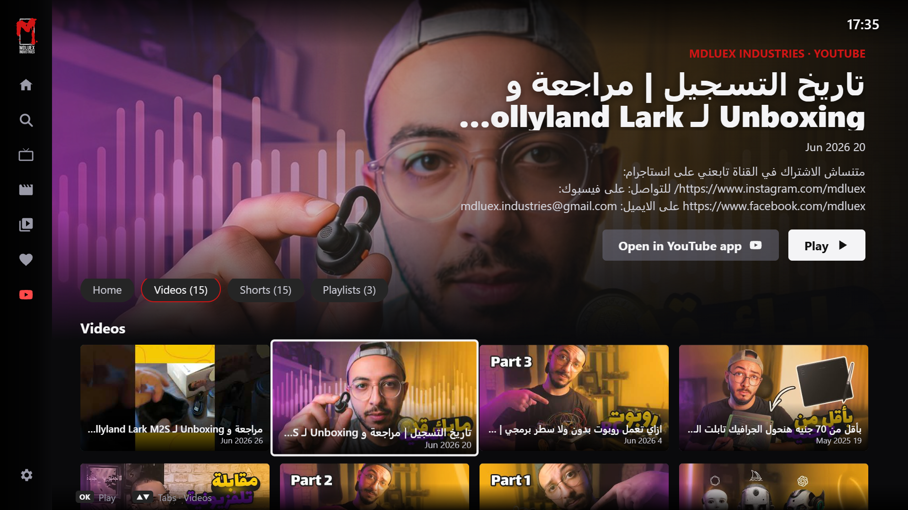

# Mdluex IPTV

A fast, Netflix-style IPTV player for **Samsung Smart TVs (Tizen)**, built for Xtream Codes servers — plus the
**Mdluex Industries** YouTube channel, watchable without any IPTV account.

> Mdluex IPTV is only a player. It contains no channels, movies or series: you sign in with the IPTV
> subscription you already have.


*The Mdluex Industries channel (Videos tab): the banner follows the focused video and plays a muted preview.*

## Features
- **Resume anywhere** – movies, episodes and YouTube videos remember where you stopped. *Continue Watching* on Home and in every section; press **Red** on a card to remove it.
- **Account that never locks you out** – the expiry date is fetched with retries; if the server is slow or down, the last known info is shown instead of a blank screen. Clear messages for wrong login, expired/banned accounts and full connection limits.
- **Featured banner** – follows the item you're on, with a muted preview (trailer clips or frames from the video).
- **Live TV** – categories with item counts, channel logos, now/next TV guide, favorites (**Yellow**), recently watched, CH ▲▼ zapping, channel list (◀), number keys, auto-reconnect, TS/HLS switch.
- **Movies & Series** – poster grids, item counts per category, Recently Added, My List, details pages, seasons & episodes with watched marks, **auto-play next episode**.
- **Player** – seek with ◀ ▶ (faster when held), FF/RW ±30 s, audio & subtitle tracks, picture mode, sleep timer.
- **Mdluex Industries channel** – Home / Videos / Shorts / Playlists tabs like YouTube, featured video, in-app playback with quality (1080p–360p), speed and subtitles.
- **Search** across channels, movies, series and channel videos.
- **Arabic / RTL** content shown right-to-left, parental PIN lock (default `0000`), multiple playlists, demo mode.

## Mdluex IPTV Server
Host your own movies, series and live channels: [`server/`](server/README.md) is a self-hosted IPTV server
(Rust, single executable, web admin panel in the same style) with an Xtream Codes compatible API —
accounts with expiry and screen limits, *Watching now*, library scanning with TMDB posters & trailers,
live TV with M3U import and XMLTV guide, **resellers & credits, packages, load-balancing edge servers,
transcoding profiles and catch-up/timeshift**. Download `MdluexIPTV-Server-…-windows.zip` from the
[latest release](https://github.com/mdluex/mdluex-iptv/releases/latest).

## How YouTube playback works
YouTube refuses players embedded directly in TV apps (they load from local files — *error 153*). The app plays
videos through a tiny player page hosted on GitHub Pages, which gives YouTube a real web address:
**[mdluex/mdluex-tv-player](https://github.com/mdluex/mdluex-tv-player)**.

## Project layout
| Path | What |
|---|---|
| `app/` | The TV app (HTML / CSS / JavaScript) |
| `app/js/channel_snapshot.js` | Offline copy of the channel – refresh with `python tools/update_channel.py` |
| `tools/install.ps1` | Build, sign, install and launch on the TV |
| `tools/tvdebug.py` | Inspect the app running on the TV (Chrome DevTools protocol) |
| `tools/sdb*.py` | Small TV developer-connection helpers |
| `tools/fix_old_tv_css.py`, `bump_version.py` | Compatibility and cache-busting helpers |
| `tools/screenshot.py` | Full-HD screenshots of the app (headless Edge), e.g. for this README |
| `iptv_check.py` | Check an IPTV server's account replies from a PC |

## Preview on a PC
```powershell
python -m http.server 8765 --directory app
```
Open http://localhost:8765 — arrow keys, Enter, Esc (Back), Space (play/pause), R/G/Y/B for the colour keys.
Choose **Try demo** for sample content. (IPTV TS/HLS streams only play on the TV.)

## Easy install (recommended)
1. **On the TV:** Apps → press `1 2 3 4 5` → Developer Mode **On** → Host PC IP = your PC's IP address → restart the TV.
2. **On a Windows PC** (same network): download **`MdluexIPTV-vX.X.X.zip`** from the
   **[latest release](https://github.com/mdluex/mdluex-iptv/releases/latest)**, extract it and double-click
   **`Install-MdluexIPTV.cmd`**.
3. The installer finds your TV, installs Samsung's free Tizen tools if needed, helps you create your Samsung
   certificate (you sign in with your own Samsung account — required by Samsung, once per TV), then signs,
   installs and opens the app. Run it again any time to update.

> Why not USB? Samsung TVs from 2017 onward only install apps from the Samsung store or through Developer
> Mode, and each app must be signed for the specific TV — the installer handles that for you.

## Install on your TV (manual)
1. **TV:** Apps → press `1 2 3 4 5` → Developer Mode **On**, Host PC IP = your PC's address → restart the TV.
2. Install **Tizen Studio** (CLI is enough) into `C:\tizen-studio`, then in its Package Manager add
   **Samsung Certificate Extension** and **TV Extensions**.
3. In **Certificate Manager** create a **Samsung → TV** profile (sign in with your Samsung account; your TV's
   DUID must be in the distributor certificate). Keep your certificate files private — never commit them.
4. Run (adjust the TV address and profile name):
```powershell
powershell -ExecutionPolicy Bypass -File tools\install.ps1 -TvIp 192.168.1.20 -CertProfile MyProfile
```

**Can't connect?** Routers sometimes give the TV or PC a new address — update the TV's Developer Mode *Host PC
IP*, restart the TV, and pass the TV's current address with `-TvIp`.

## Compatibility
Tested on a 2021 Samsung TV (Tizen 6.0, Chrome 76 engine). Older engines lack some CSS (`inset`, flex `gap`);
the app includes fallbacks.

## Author
**Mahmoud Salah** — [Mdluex Industries on YouTube](https://www.youtube.com/@Mdlu3x)
