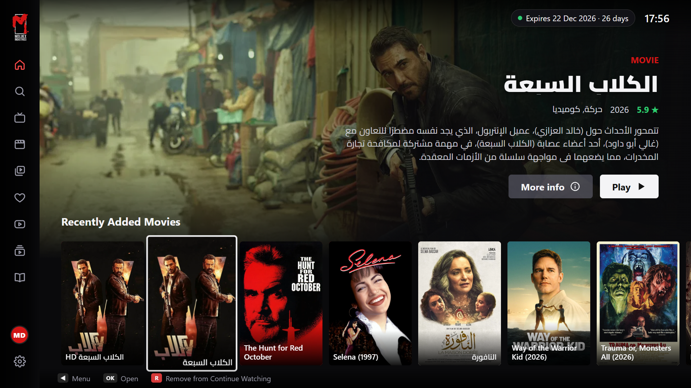
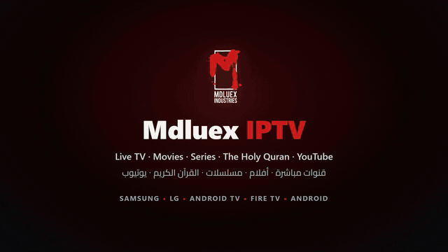
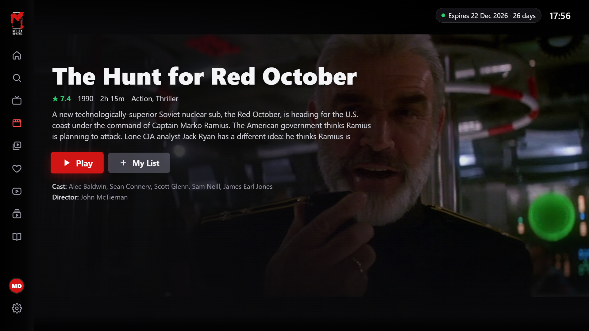
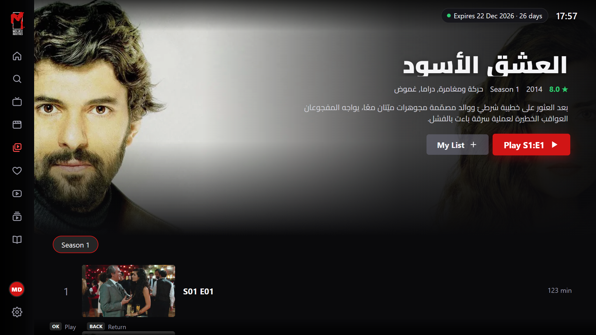
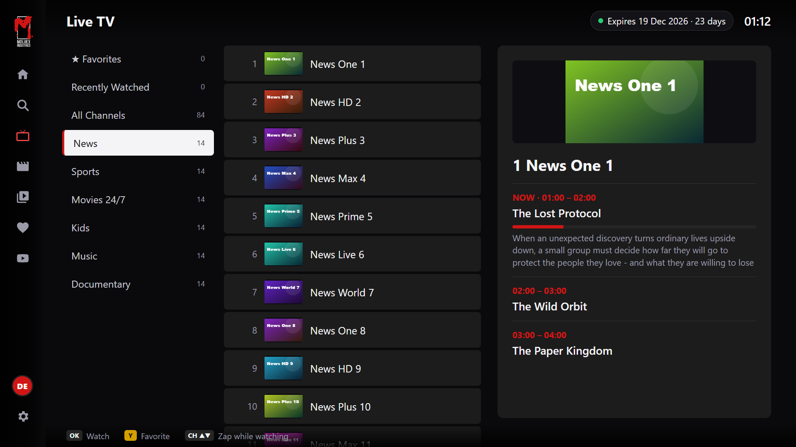

<p align="right"><a href="README.ar.md"><b>اقرأ بالعربية 🇪🇬</b></a></p>

# Mdluex IPTV

### 👉 Install it on your TV: **[iptv.mdluex.com](https://iptv.mdluex.com)**
Pick your TV and follow the pictures — with download buttons for the newest version (English and Arabic).

Watch your IPTV subscription on your smart TV in a clean, Netflix-style app: live TV, movies and series, all in
one place. It also includes the **Mdluex Industries** YouTube channel, which you can watch with no subscription at all.

Works on **Samsung**, **LG**, **Android TV / Google TV** and **Amazon Fire TV**.

> **Good to know:** Mdluex IPTV is only a player. It does not come with any channels, movies or series. You sign in
> with the IPTV subscription you already have (the *server address*, *username* and *password* your provider gave
> you — often called an "Xtream Codes" login).



## Contents
- [Install it on your TV](#install)
- [First time: add your subscription](#first-time)
- [Using the remote](#remote)
- [What it can do](#features)
- [Updating](#updating)
- [Problems and questions](#help)
- [Screenshots and video](#screenshots)
- [License](#license)

<a id="install"></a>
## Install it on your TV
Pick your TV:

| Your TV | How hard? | Go to |
|---|---|---|
| **Amazon Fire TV** (Stick, Cube, Fire TV smart TVs) | Easy — about 5 minutes | [Fire TV](#firetv) |
| **Android TV / Google TV** (Chromecast, Shield, Mi Box, Sony, TCL, Hisense…) | Easy — about 5 minutes | [Android TV](#androidtv) |
| **Samsung** (2018 and newer) | Medium — needs a phone or computer once | [Samsung](#samsung) |
| **LG** (2021 and newer, webOS 6+) | Harder — needs a computer once | [LG](#lg) |

<a id="firetv"></a>
### Amazon Fire TV
1. On your Fire TV, search for **Downloader** in the app store and install it (it's free).
2. Go to **Settings → My Fire TV → Developer options → Install unknown apps** and turn it on for **Downloader**.
   - Don't see *Developer options*? Go to **Settings → My Fire TV → About**, click on your device's name
     **7 times**, then go back — it appears.
3. Open **Downloader**, type this address and press **Go**:
   ```
   mdluex.github.io/mdluex-iptv/apk
   ```
4. The newest version downloads by itself. Choose **Install**, then **Open**.
5. Later you'll find it under **Your Apps & Channels**.

> Some of the newest Fire TV devices run **Vega OS** instead of Fire OS. Those can't install apps from outside
> Amazon's store, so Mdluex IPTV won't work on them.

<a id="androidtv"></a>
### Android TV / Google TV
1. On your TV, install a free app that can download files, such as **Downloader** from the Google Play Store.
2. Open it and go to this address:
   ```
   mdluex.github.io/mdluex-iptv/apk
   ```
3. When Android asks, allow it to **install unknown apps**, then choose **Install**.
4. Open **Mdluex IPTV** from your apps.

You can also download the file ending in **`-android.apk`** from the
[latest release](https://github.com/mdluex/mdluex-iptv/releases/latest) on a computer, copy it to a USB stick and
open it on the TV with a file manager.

<a id="samsung"></a>
### Samsung
Samsung TVs only accept apps from outside their store when the app is made for *your* TV. A free tool called
**Apps2Samsung** does that for you.

**Step 1 — on the TV: turn on Developer Mode**
1. Open **Apps** on the TV.
2. Press **1 2 3 4 5** on the remote (on remotes without numbers, use the on-screen number pad). A *Developer Mode*
   window opens.
3. Switch it **On**, and in **Host PC IP** type the address of the phone or computer you'll use in step 2.
   (On a phone: Settings → Wi-Fi → your network → IP address.)
4. Turn the TV off and on again.

**Step 2 — on your phone or computer: install the app with Apps2Samsung**
1. Download **[Apps2Samsung](https://github.com/Apps2Samsung/Apps2Samsung)** (Windows, Mac, Linux, Android or iPhone).
   The phone or computer must be on the same Wi-Fi as the TV.
2. Open Apps2Samsung and find **Mdluex IPTV** in its app list (under *Media servers & players*, or use search).
3. Install it. The first time, it asks you to sign in with a free Samsung account — Samsung requires this to make the
   app work on your TV.

> Don't see it in the list? In Apps2Samsung open **Settings → Installing → Your sources**, add
> `github.com/mdluex/mdluex-iptv`, and look again.

<details>
<summary><b>Prefer a Windows computer? Use the one-click installer instead</b></summary>

1. Do *Step 1* above, using your computer's address as **Host PC IP**.
2. On the computer, download the file ending in **`.zip`** from the
   [latest release](https://github.com/mdluex/mdluex-iptv/releases/latest), unzip it and double-click
   **`Install-MdluexIPTV.cmd`**.
3. Follow the screens: it finds your TV, sets up everything it needs, asks you to sign in with your Samsung account
   once, and installs the app. Run it again any time to update.
</details>

<a id="lg"></a>
### LG
LG only allows apps from outside its store through its **Developer Mode** app, plus a free community app store called
**Homebrew Channel**. You set this up once; after that, installing and updating is easy.

1. On a computer or phone, create a free account at
   [webostv.developer.lge.com](https://webostv.developer.lge.com).
2. On the TV, install **Developer Mode** from the LG Content Store, sign in with that account and turn
   **Dev Mode Status** on. The TV restarts.
3. Install **Homebrew Channel** on the TV by following the
   [Homebrew Channel guide](https://www.webosbrew.org/devmode/) (it uses a free computer program called
   *webOS Dev Manager*).
4. On the TV, open **Homebrew Channel → Settings → Add repository** and enter:
   ```
   https://mdluex.github.io/mdluex-iptv/lg/apps.json
   ```
5. Go back to the app list, find **Mdluex IPTV** and install it.

> LG's Developer Mode turns itself off after 1000 hours (about 6 weeks). Open the **Developer Mode** app on the TV
> now and then and press **Extend** so your apps keep working.

<a id="first-time"></a>
## First time: add your subscription
1. Open **Mdluex IPTV** and choose **Add IPTV playlist**.
2. Fill in what your IPTV provider gave you:
   - **Name** — anything you like, e.g. *My IPTV*
   - **Server address** — e.g. `http://example.com:8080`
   - **Username** and **Password**
3. Save. Your channels, movies and series load, and your subscription's expiry date shows at the top.

Just want to look around first? Choose **Try demo** for sample content, or **Watch Mdluex Channel**.
You can add more than one subscription and switch between them in **Settings**.

<a id="remote"></a>
## Using the remote
The arrows move around, **OK** selects and **Back** goes back. A few extras depend on your remote:

| To… | Samsung / LG remote | Fire TV remote | Other Android TV remotes |
|---|---|---|---|
| Add to or remove from **My List** | 🟡 Yellow button | **☰** (Menu) | **Hold OK** |
| Remove from **Continue Watching** | 🔴 Red button | **☰** (Menu) | **Hold OK** |
| Change channel while watching | **CH ▲▼** or **▲▼** | **▲▼** | **▲▼** |
| Show the channel list while watching | **◀** | **◀** | **◀** |
| Rewind / fast-forward | **◀ ▶** (hold to go faster) | same | same |
| Audio language, subtitles, picture size, sleep timer, next episode | **▲** while watching | same | same |

The bottom of the screen always shows which buttons do what on the screen you're on.

<a id="features"></a>
## What it can do
- **Continue where you stopped** — movies, episodes and videos remember your spot.
- **Live TV** with channel logos, a TV guide (what's on now and next), favourites and recently watched channels.
- **Movies and series** with posters, *Recently Added*, *My List*, seasons and episodes, and the next episode
  playing by itself.
- **Search** across channels, movies, series and Mdluex videos.
- **Choose audio language and subtitles**, change the picture size, and set a **sleep timer**.
- **Parental lock** for adult categories with a PIN (the starting PIN is **0000** — change it in Settings).
- **Arabic or English** — the app follows your TV's language automatically, and in Arabic the whole app reads
  right-to-left. Change it any time in **Settings → Language**.
- **Your subscription's expiry date** is always shown, and the app keeps working with the last known details if the
  server is slow.
- **Mdluex Industries channel** — watch the YouTube channel inside the app, no subscription needed.
- **Your own YouTube channels** — in **YouTube Channels**, choose **Add channel** and search by name, @handle or link.
  Their latest videos show on Home too. (Mdluex Industries always stays.)
- **Quran** — choose a surah and a reciter, and listen while you read: the page looks like a printed mushaf and the
  verse and the word being recited light up as you listen. 12 famous reciters, repeat a verse, continue to the next
  surah, and it remembers where you stopped. ▲▼ move between verses, ◀▶ between surahs.

<a id="updating"></a>
## Updating
- **Fire TV / Android TV:** do the install steps again (Downloader → `mdluex.github.io/mdluex-iptv/apk`). Your
  subscription and favourites are kept.
- **Samsung:** Apps2Samsung shows when there's an update — install it from there.
- **LG:** Homebrew Channel shows when there's an update.

<a id="help"></a>
## Problems and questions
**A live channel freezes or won't play.**
Go to **Settings → Live TV stream type** and switch between *MPEG-TS* and *HLS*. One of them usually works better
with your provider. If it still doesn't play, the channel may be down at your provider.

**It says my login is wrong or my account expired.**
Check the server address, username and password with your IPTV provider. Mdluex IPTV can't fix a subscription
problem — only your provider can.

**"Too many connections".**
Your subscription allows a limited number of screens at once. Stop watching on another device and try again.

**Samsung: Apps2Samsung can't find or connect to my TV.**
Make sure the phone/computer and the TV are on the same Wi-Fi. Routers sometimes change addresses: check the
address of your phone/computer again, put it in the TV's **Developer Mode → Host PC IP**, and restart the TV.

**LG: the app stopped opening after a few weeks.**
LG's Developer Mode ran out. Open the **Developer Mode** app on the TV, sign in, and turn it on again (or press
**Extend** before it runs out).

**I forgot my parental PIN.**
The starting PIN is **0000**. If you changed it and forgot it, uninstall the app and install it again (on Fire TV and
Android TV you can instead clear the app's data in the TV's app settings). This also removes your saved
subscription, so you'll need to add it again.

**Does it cost anything? Does it include channels?**
The app is free. It doesn't include any channels — you need your own IPTV subscription.

Still stuck? Email **[hello@mdluex.com](mailto:hello@mdluex.com)** or [open an issue](https://github.com/mdluex/mdluex-iptv/issues) — tell us your TV model and what happens.

<a id="screenshots"></a>
## Screenshots and video
[](docs/demo.mp4)

▶ **[Watch the demo video (1:42)](docs/demo.mp4)** — recorded on a Samsung TV.

| | |
|---|---|
|  |  |
| Movies | Movie details |
|  |  |
| Series, seasons and episodes | Live TV with TV guide |

## Run your own IPTV server
Have your own movies, series or channels? **[Mdluex IPTV Server](server/README.md)** is a free server program for
Windows with an easy web admin panel. It works with this app and with other IPTV players.

## For developers
How to build, test and release the app: **[DEVELOPERS.md](DEVELOPERS.md)**.

<a id="license"></a>
## License
**Free for personal use** — see [LICENSE](LICENSE).

- ✅ You may use it, install it for your family, change it for yourself, and share it **for free** (keep the
  license and credit).
- ❌ **Not allowed without my written permission:** selling it, charging people to use it, using it for **paid
  IPTV subscriptions or a reseller business**, putting it in a commercial product, or publishing it on an app store.

The free community stores of [Apps2Samsung / TV-Store](https://github.com/Apps2Samsung/tizen-community-packages)
and the [webOS Homebrew Channel](https://github.com/webosbrew/apps-repo) have permission to list Mdluex IPTV and
share the unchanged official releases from this page.

Want to use it commercially? **Contact me first** at **[hello@mdluex.com](mailto:hello@mdluex.com)**.

## Author
**Mahmoud Salah** — website **[www.mdluex.com](https://www.mdluex.com)** · support & business **[hello@mdluex.com](mailto:hello@mdluex.com)** · [Mdluex Industries on YouTube](https://www.youtube.com/@Mdlu3x)
